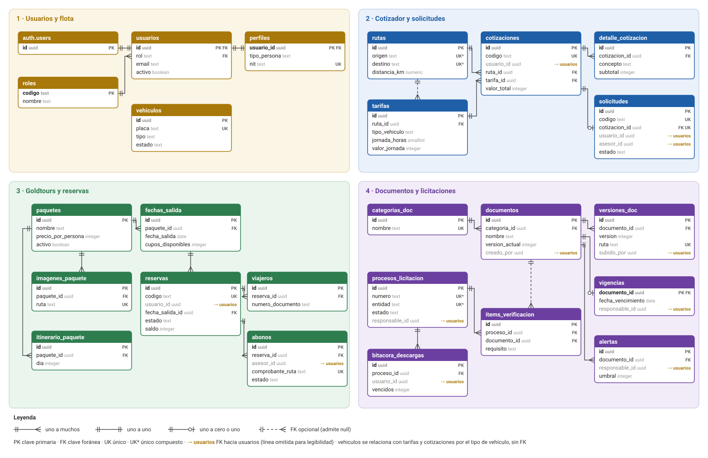
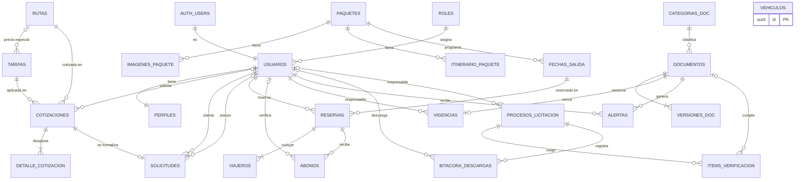
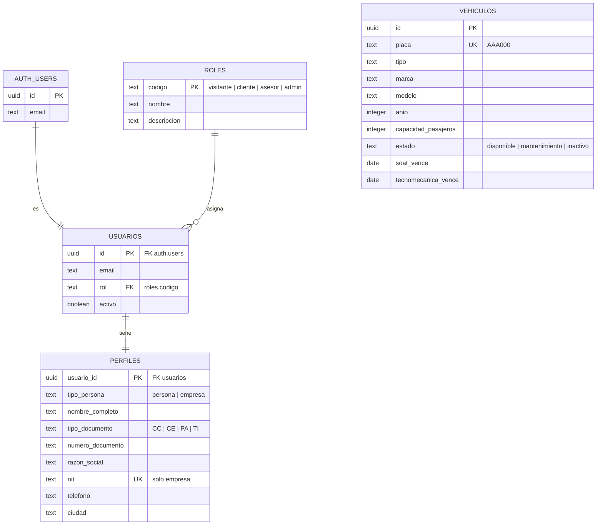
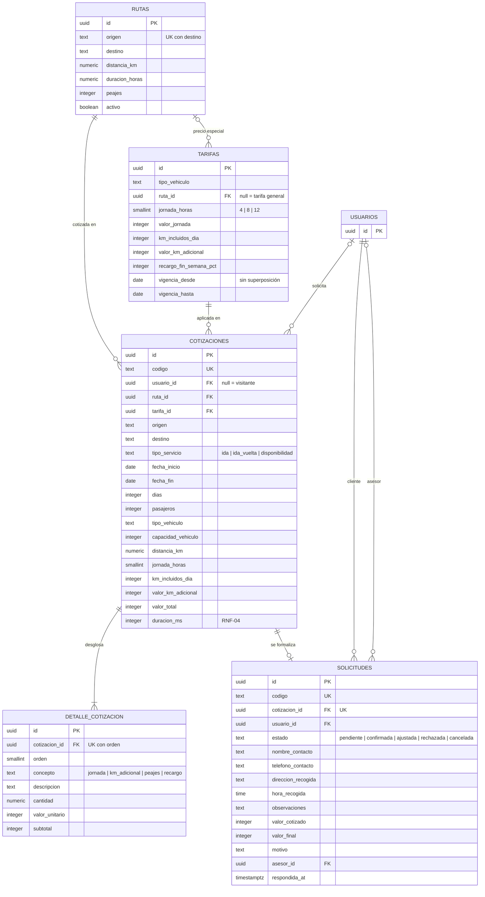
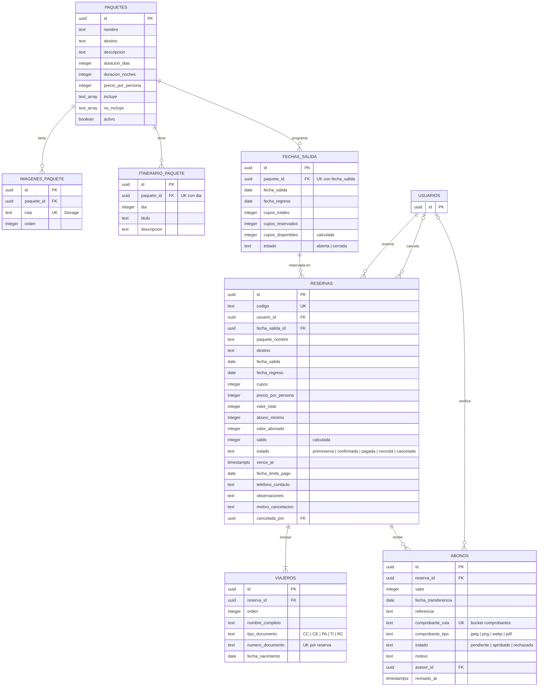
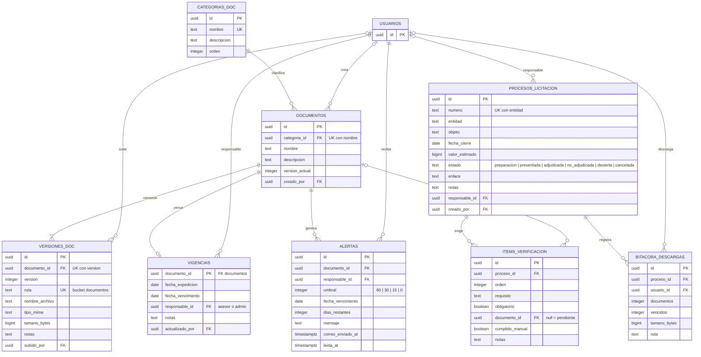

# Modelo entidad-relación — GOLDTRANS App

Modelo de la base de datos en Supabase (esquema `public`), construido a partir de las migraciones de
`supabase/migrations/`. Todas las tablas tienen RLS activado; los permisos por rol están en
[arquitectura.md](arquitectura.md) y en cada migración.

Convenciones: **PK** clave primaria · **FK** clave foránea · **UK** valor único. Los valores en pesos
colombianos son `integer`. Las fechas y horas de auditoría (`created_at`, `updated_at`) se omiten en
los diagramas para que sean legibles.

## Diagrama

> Imagen: [`img/modelo-entidad-relacion.svg`](img/modelo-entidad-relacion.svg) (vectorial, se abre en
> cualquier navegador) · [`img/modelo-entidad-relacion.png`](img/modelo-entidad-relacion.png) (alta
> resolución, para Word, PowerPoint o Canva).

## Vista general (Mermaid)

`VEHICULOS` no tiene claves foráneas: se relaciona con `tarifas` y `cotizaciones` por el valor de
`tipo` / `tipo_vehiculo` (automovil, campero, camioneta, van, microbus, buseta, bus).

---

## 1. Usuarios y flota (Sprint 1)

## 2. Cotizador y solicitudes (Sprints 2–3)

## 3. Goldtours y reservas (Sprints 3–4)

## 4. Repositorio documental y licitaciones (Sprints 4–5)

---

## Relaciones y reglas de borrado

| Relación | Cardinalidad | Al borrar el padre |
|---|---|---|
| `auth.users` → `usuarios` | 1 : 1 | cascade |
| `roles` → `usuarios.rol` | 1 : N | restrict |
| `usuarios` → `perfiles` | 1 : 1 | cascade |
| `rutas` → `tarifas.ruta_id` | 1 : N (opcional) | cascade |
| `rutas` / `tarifas` → `cotizaciones` | 1 : N | restrict |
| `usuarios` → `cotizaciones` | 1 : N (opcional) | set null |
| `cotizaciones` → `detalle_cotizacion` | 1 : N | cascade |
| `cotizaciones` → `solicitudes` | 1 : 0..1 | restrict |
| `usuarios` → `solicitudes` (cliente / asesor) | 1 : N | cascade / set null |
| `paquetes` → `imagenes_paquete`, `itinerario_paquete`, `fechas_salida` | 1 : N | cascade |
| `fechas_salida` → `reservas` | 1 : N | restrict |
| `usuarios` → `reservas` | 1 : N | restrict |
| `reservas` → `viajeros`, `abonos` | 1 : N | cascade |
| `usuarios` → `abonos.asesor_id` | 1 : N (opcional) | set null |
| `categorias_doc` → `documentos` | 1 : N | restrict |
| `documentos` → `versiones_doc` | 1 : N | cascade |
| `documentos` → `vigencias` | 1 : 0..1 | cascade |
| `documentos` → `alertas` | 1 : N | cascade |
| `usuarios` → `vigencias.responsable_id` | 1 : N | restrict |
| `procesos_licitacion` → `items_verificacion`, `bitacora_descargas` | 1 : N | cascade |
| `documentos` → `items_verificacion` | 1 : N (opcional) | set null |

## Reglas de negocio reflejadas en el modelo

- **Tarifas sin superposición:** restricción `exclude using gist` sobre tipo de vehículo, ruta,
  jornada y rango de vigencia.
- **Cotización inmutable:** `cotizaciones` copia origen, destino, distancia y condiciones de la tarifa
  para que el historial no cambie si después se edita la ruta o la tarifa.
- **Una solicitud por cotización:** `solicitudes.cotizacion_id` es único.
- **Cupos:** `fechas_salida.cupos_disponibles = cupos_totales − cupos_reservados` (columna calculada);
  `liberar-cupos` devuelve los cupos de las prerreservas vencidas.
- **Saldo:** `reservas.saldo = valor_total − valor_abonado` (columna calculada); solo los abonos
  aprobados suman a `valor_abonado`.
- **Historial documental:** cada carga crea una fila en `versiones_doc` y actualiza
  `documentos.version_actual`.
- **Alertas sin duplicados:** único por (`documento_id`, `fecha_vencimiento`, `umbral`).
