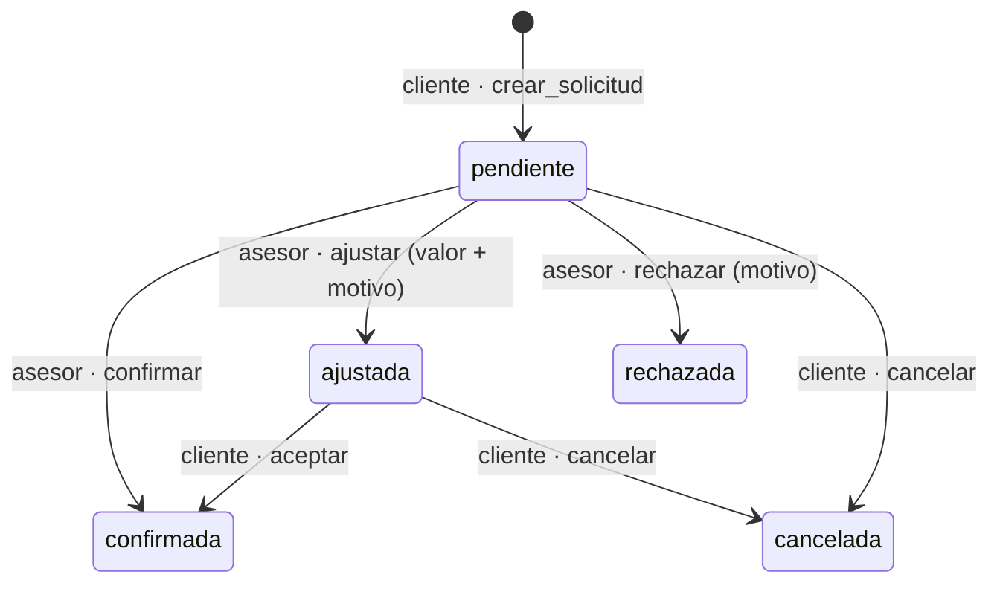

# Sprint 3 — Cotización formal y catálogo Goldtours

## Qué incluye

| Ítem | Implementación |
|---|---|
| HU-15 Enviar y descargar cotización | `src/lib/compartir.ts` · `components/acciones-compartir.tsx`: WhatsApp (`wa.me`), correo (`mailto:`) y PDF (`expo-print` + `expo-sharing`; en web abre el diálogo de impresión) |
| HU-16 Solicitud formal | `components/modal-solicitud.tsx` (desde el resultado del cotizador o el historial) · función `crear_solicitud()` · pestaña `(client)/mis-solicitudes.tsx` |
| HU-17 Gestión del asesor | `components/bandeja-solicitudes.tsx` en `(advisor)/solicitudes.tsx` y en el admin (desde el Sprint 4, pestaña *Ventas*: `(admin)/ventas.tsx`) · función `responder_solicitud()` |
| HU-18 Catálogo con filtros | `(public)/goldtours.tsx`: búsqueda sin tildes, destino, duración y orden (próxima salida / precio) |
| HU-19 Ficha del paquete | `(public)/paquete/[id].tsx`: galería, precio, fechas con cupos, itinerario, incluye / no incluye |
| HU-20 Fechas de salida con cupos | tabla `fechas_salida` · editor en `(admin)/paquetes/[id].tsx` |
| HU-21 Crear y actualizar paquetes | `(admin)/paquetes/` · fotos en el bucket público `paquetes` (`expo-image-picker`) |
| RNF-05 Android e iOS | `npx expo export --platform android --platform ios` compila. **Falta probar en un dispositivo Android real y en el simulador de iOS** (ver abajo) |

> El catálogo está en `(public)` y no en `(client)`, como proponía la estructura inicial, porque los visitantes
> también pueden verlo (matriz de permisos de `docs/arquitectura.md`).

## Flujo de una solicitud



- Los estados **solo cambian por funciones** (`crear_solicitud`, `responder_solicitud`, `decidir_solicitud`).
  Ningún rol puede insertar ni modificar `solicitudes` directamente.
- Una cotización se formaliza **una sola vez** (`unique` en `cotizacion_id`) y solo si su fecha no ha pasado.
- La base exige el motivo al rechazar o ajustar (`solicitudes_motivo_requerido`).
- `valor_cotizado` se copia de la cotización y `valor_final` lo fija el asesor. El cliente ve el valor anterior tachado.

## Cupos

- `cupos_disponibles` es una columna generada: `cupos_totales - cupos_reservados`.
- La restricción `fechas_salida_cupos` **impide vender más cupos de los que hay**, incluso con peticiones simultáneas.
- `cupos_reservados` no se edita desde la app, ni siquiera el admin (permisos por columna). Lo moverán las reservas del Sprint 4.
- Estados en la app: *Disponible*, *Últimos cupos* (5 o menos), *Agotada*, *Cerrada* (el admin la cierra) y *Ya salió*.
  Solo las dos primeras se pueden elegir en la ficha.

## Catálogo público

Un paquete aparece en el catálogo si está **activo y tiene al menos una foto** (función `paquete_publicado()`,
usada por las políticas RLS). Las fotos van en el bucket público `paquetes`: cualquiera las ve y solo el admin las
sube o las borra. Máximo 5 MB; JPG, PNG o WebP.

## Pasos para dejarlo funcionando

```bash
npx supabase db push        # 20261015000000_solicitudes_goldtours.sql (ya aplicada el 14-oct-2026)
npx jest                    # 113 pruebas
npm run test:db             # pgTAP: solicitudes_goldtours.test.sql (28 aserciones, requiere Docker)
```

Dependencias nuevas: `expo-print`, `expo-sharing` y `expo-image-picker`. `app.json` declara el permiso de fotos
para iOS. Como son módulos nativos, **hay que volver a generar el build de desarrollo** (`npx expo run:android` /
`run:ios`). Expo Go ya los trae.

## RNF-05 · Lista de verificación en dispositivos

Probar en **Android real** y **simulador iOS**:

- [ ] Cotizar → WhatsApp abre la app con el texto; Correo abre el cliente de correo; PDF abre el menú de compartir
- [ ] Solicitar servicio desde el resultado y desde el historial; aparece en Solicitudes como *Pendiente*
- [ ] Asesor: filtrar, confirmar, ajustar y rechazar; el botón WhatsApp abre el chat con el cliente
- [ ] Cliente: aceptar un ajuste y cancelar una pendiente
- [ ] Catálogo: filtros, galería deslizable, fechas agotadas sin poder elegirse
- [ ] Admin: crear paquete, subir foto desde la galería (pide permiso en iOS), cambiar portada, itinerario y fechas
- [ ] Pestañas del admin (6) legibles en un teléfono pequeño
