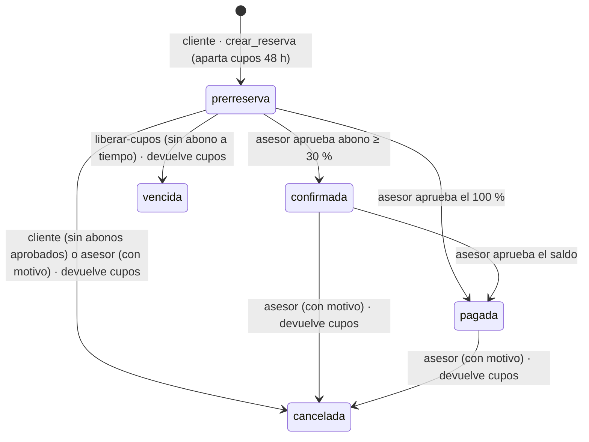

# Sprint 4 — Reservas, abonos y repositorio documental

## Qué incluye

| Ítem | Implementación |
|---|---|
| HU-22 Reserva con viajeros | Botón *Reservar esta fecha* en `(public)/paquete/[id].tsx` → `(client)/reservas/nueva.tsx` · función `crear_reserva()` · tablas `reservas` y `viajeros` |
| HU-23 Abono con comprobante | `(client)/reservas/[id].tsx`: valor, fecha, referencia y comprobante (foto/captura o PDF) · `registrar_abono()` · bucket privado `comprobantes` |
| HU-24 Verificación del asesor | `components/bandeja-reservas.tsx` en `(advisor)/abonos.tsx` (pestaña *Reservas*) y en `(admin)/ventas.tsx` · el comprobante se ve en la app antes de aprobar · `verificar_abono()` |
| HU-25 Saldo y fecha límite | `resumenPagos()`, `fechaLimitePago()` y `saldoVencido()` en `src/lib/reservas.ts` · columna generada `saldo` · aviso de *pago atrasado* en la bandeja |
| HU-26 Estados y cupos vencidos | Edge Function `supabase/functions/liberar-cupos/` → `vencer_prerreservas()` · programada con `pg_cron` cada 15 min · `cancelar_reserva()` |
| HU-27 Documentos por categoría | `components/repositorio-documentos.tsx` en `(advisor)/documentos/` y `(admin)/documentos/` · tablas `categorias_doc`, `documentos`, `versiones_doc` · bucket privado `documentos` |
| RNF-06 Almacenamiento seguro | Buckets privados con URLs firmadas de 5 minutos, carpetas por dueño, límites de tamaño y tipo, archivos inmutables (ver abajo) |

> **Pestañas del admin:** con Reservas y Documentos serían 8 pestañas, y no caben en un teléfono. Solicitudes y Reservas
> quedan juntas en **Ventas** (`(admin)/ventas.tsx`, con un selector arriba) y Documentos aparece como **Docs**.
> El asesor tiene tres pestañas: Solicitudes, Reservas y Documentos.

## Flujo de una reserva



| Regla | Valor | Dónde |
|---|---|---|
| Plazo de la prerreserva | 48 horas (nunca después del inicio de la salida) | `crear_reserva()` · `HORAS_PRERRESERVA` |
| Abono mínimo para confirmar | 30 % del total, redondeado hacia arriba | `crear_reserva()` · `abonoMinimo()` |
| Fecha límite del saldo | 8 días antes de la salida; en reservas de última hora, al menos 2 días y nunca después del día anterior | `crear_reserva()` · `fechaLimitePago()` |
| Viajeros por reserva | 1 a 20, sin documentos repetidos | `crear_reserva()` · `validarReserva()` |
| Abono rechazado en una prerreserva | el cliente tiene 24 h más para enviar otro comprobante | `verificar_abono()` |

- Los estados **solo cambian por funciones**. Ningún rol puede insertar ni modificar `reservas`, `viajeros` ni `abonos`
  directamente. La app solo tiene permiso de lectura y RLS filtra lo propio.
- **Sin sobreventa:** `crear_reserva()` bloquea la fila de la fecha (`for update`), primero libera las prerreservas vencidas
  de esa fecha y después cuenta. `fechas_salida_cupos` sigue siendo la última barrera.
- **Abono en revisión = no vence.** Si el asesor tarda, la prerreserva no se pierde. Si rechaza el comprobante, el
  cliente recibe 24 h más.
- La reserva **copia** el nombre del paquete, el destino y las fechas, así no cambia si el paquete se edita o se despublica.
  Una fecha o un paquete con reservas **no se borra** (FK); se cierra o se desactiva.
- **Saldo atrasado:** no se cancela solo, porque ya hay dinero abonado. La bandeja lo marca en rojo y el asesor decide.
  La devolución de dinero se gestiona por fuera de la app.
- El pago es **por transferencia** (no hay pasarela). La cuenta que ve el cliente sale de `EXPO_PUBLIC_DATOS_TRANSFERENCIA`.
  Si está vacía, la app le pide pedirla a un asesor.

## RNF-06 · Almacenamiento seguro

| Bucket | Público | Máximo | Tipos | Ruta | Quién escribe | Quién lee |
|---|:-:|---|---|---|---|---|
| `comprobantes` | No | 5 MB | JPG, PNG, WebP, PDF | `<usuario_id>/<reserva_id>/<marca>-<aleatorio>.<ext>` | El cliente, solo en reservas suyas | El dueño, asesor y admin |
| `documentos` | No | 20 MB | PDF, imágenes, Word, Excel | `<categoria_id>/<marca>-<aleatorio>.<ext>` | Asesor y admin | Asesor y admin |

- Ninguno de los dos buckets tiene política de *update*: un archivo subido no se reemplaza. Cada versión nueva es otro archivo.
- El cliente solo puede borrar un comprobante que **no** quedó registrado en un abono (limpieza si falla el registro).
  En `documentos` solo el admin borra.
- `registrar_abono()` comprueba que la ruta esté en la carpeta del cliente y de esa reserva, y que el archivo exista.
  El **tipo** se lee de Storage, no de lo que envía la app. `crear_documento()` y `agregar_version_documento()` también toman
  de Storage el tipo y el **tamaño real**.
- Para ver o descargar se usa `createSignedUrl` con 5 minutos de validez. No hay URLs permanentes.

## Repositorio documental (HU-27)

- Siete categorías iniciales: Legales, Habilitación, Financieros, Pólizas, Vehículos, Conductores y Experiencia. El admin
  puede crear más.
- Cada documento tiene su historial: *Subir nueva versión* agrega la versión N+1 y la anterior sigue disponible.
- El nombre no se repite dentro de la categoría (sin distinguir mayúsculas).
- Asesor y admin cargan documentos y editan sus datos. Solo el admin los elimina, con todas sus versiones y archivos.
- La búsqueda por texto y el filtro por categoría ya funcionan. El buscador por estado de vigencia (HU-30) y las alertas
  (HU-28) son del Sprint 5.

## Pasos para dejarlo funcionando

### 1. Migración, función y secreto

```bash
npx supabase db push                               # 20261021000000_reservas_documentos.sql
npx supabase secrets set CRON_SECRET=<cadena-larga-aleatoria>
npx supabase functions deploy liberar-cupos
```

### 2. Programación cada 15 minutos (una sola vez, en el SQL Editor de Supabase)

La migración ya creó la tarea `liberar-cupos` en `pg_cron`. Solo faltan la URL y el secreto en Vault, que no van en el
repositorio:

```sql
select vault.create_secret('https://<proyecto>.supabase.co', 'project_url');
select vault.create_secret('<el mismo CRON_SECRET>', 'cron_secret');
```

Verificación: `select * from cron.job_run_details order by start_time desc limit 5;`. Mientras no estén los secretos,
la tarea falla sin efectos, `crear_reserva()` sigue liberando los cupos de la fecha que se reserva y la app muestra
como *Vencida* toda prerreserva cuyo plazo pasó.

### 3. App

- Agrega `EXPO_PUBLIC_DATOS_TRANSFERENCIA` al `.env` (ver `.env.example`).
- Dependencias nuevas: `expo-document-picker` y `expo-file-system`. Son módulos nativos, así que **hay que volver a generar
  el build de desarrollo** (`npx expo run:android` / `run:ios`). Expo Go ya los trae.

### 4. Pruebas

```bash
npx jest                    # 137 pruebas (sprint4.test.ts: reglas, saldo, estados, archivos, documentos)
npm run test:db             # pgTAP: reservas_documentos.test.sql (60 aserciones, requiere Docker)
```

## Lista de verificación en dispositivo

- [ ] Cliente: ficha del paquete → elegir fecha → *Reservar esta fecha* → 2 viajeros → ve su código `GT-…` y el plazo de 48 h
- [ ] Una fecha sin cupos suficientes no deja reservar; los cupos de la ficha bajan al reservar
- [ ] Adjuntar comprobante como foto (pide permiso de fotos en iOS) y como PDF; el abono queda *En revisión*
- [ ] Asesor → Reservas → *Abonos por verificar*: ve la imagen del comprobante (y abre el PDF), aprueba → reserva *Confirmada*
- [ ] Rechazar con motivo: el cliente ve el motivo y puede enviar otro comprobante
- [ ] Pagar el saldo → *Pagada*
- [ ] Cancelar una prerreserva (cliente) y una confirmada (asesor, con motivo): los cupos vuelven a la fecha
- [ ] Con la tarea programada activa, una prerreserva sin abono pasa a *Vencida* a las 48 h y libera sus cupos
- [ ] Documentos: subir un PDF en *Legales*, subir una versión 2, abrir ambas versiones
- [ ] Un cliente no ve la pestaña ni los datos de Documentos (y la API devuelve 0 filas)
